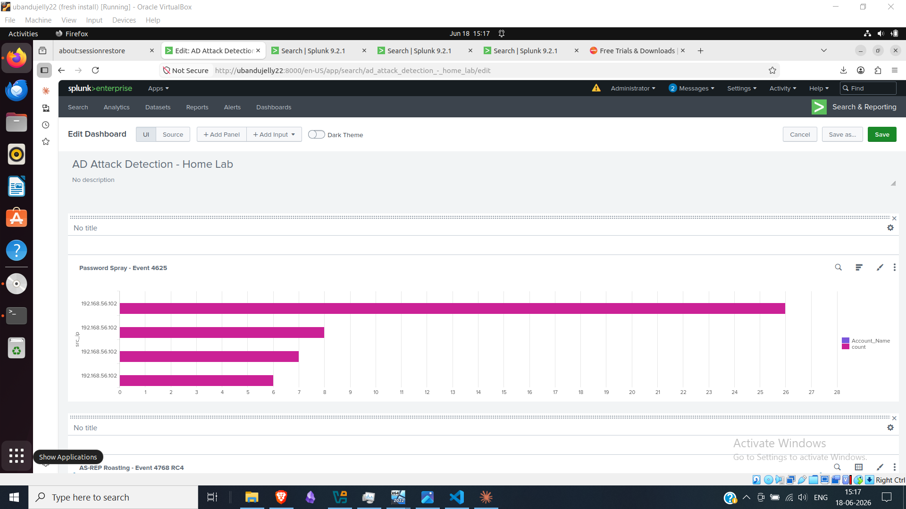
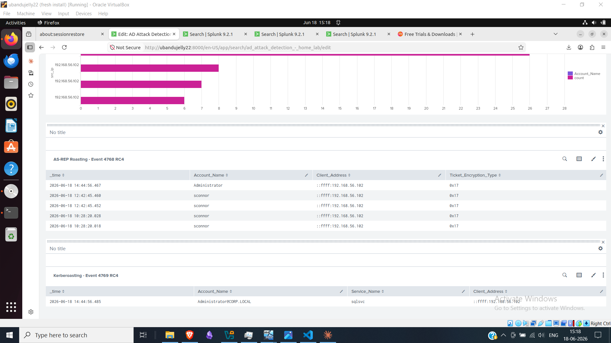

# Project 8 — Active Directory Attack & Defence Lab

A home lab simulating real-world Active Directory attacks and detecting them using Splunk SIEM. Built to demonstrate SOC analyst skills — log analysis, threat detection, and SIEM query writing.

---
## Table of Contents

* [Lab Architecture](#lab-architecture)
* [Attacks Simulated & Detected](#attacks-simulated--detected)
* [Splunk Dashboard](#splunk-dashboard)
* [Windows Security Events](#windows-security-events)
* [Tools Used](#tools-used)
* [Project Structure](#project-structure)
* [Skills Demonstrated](#skills-demonstrated)


## Lab Architecture

| Machine | OS                  | IP             | Role               |
|---------|---------------------|----------------|--------------------|
| DC01    | Windows Server 2022 | 192.168.56.10  | Domain Controller  |
| WS01    | Windows 10 21H2     | 192.168.56.11  | Victim Workstation |
| Kali    | Kali Linux 2026.1   | 192.168.56.102 | Attacker           |
| Ubuntu  | Ubuntu 22.04        | 192.168.1.42   | Splunk SIEM        |

All VMs hosted on VirtualBox with a host-only network. Splunk Universal Forwarder deployed on DC01 and WS01, forwarding Windows Security Event Logs to the Ubuntu Splunk instance.

---

## Attacks Simulated & Detected

### 1 — Password Spray
- **Tool:** Impacket / CrackMapExec
- **Target:** Domain user `jsmith` (weak password)
- **Event Generated:** 4625 — Failed Logon
- **Detection:** 22 failed logon attempts from single IP in short window

**Splunk Query:**
```spl
index=main EventCode=4625
| rex field=Message "Source Network Address:\s+(?<src_ip>\d+\.\d+\.\d+\.\d+)"
| stats count by src_ip, Account_Name
| where count > 5
| sort -count
```
**SOC Analyst Interpretation**

* **Observation:** The query identifies source IP addresses and account names associated with repeated failed logon events (Event ID 4625).
* **Investigation:** Review the time window, source IP, targeted accounts, logon type, and any successful logons that follow the failures.
* **Detection logic:** The current threshold flags more than five failures grouped by source IP and account name. This is a starting point for lab testing, not a universal production threshold.
* **Potential false positives:** Mistyped passwords, stale saved credentials, and misconfigured services can generate repeated failures.
* **Recommended response:** Validate the activity against expected user behaviour and other logs. If malicious activity is supported by the evidence, follow the organisation's incident-response process.

---

### 2 — AS-REP Roasting
- **Tool:** Impacket GetNPUsers.py
- **Target:** `sconnor` — configured with DoesNotRequirePreAuth = True
- **Event Generated:** 4768 — Kerberos TGT Request with RC4 encryption (0x17)
* **Detection:** Event ID 4768 TGT requests using RC4 encryption (`0x17`) are flagged for investigation, particularly when associated with accounts configured without Kerberos pre-authentication.

**Splunk Query:**
```spl
index=main EventCode=4768 Ticket_Encryption_Type=0x17
| table _time, Account_Name, Client_Address, Ticket_Encryption_Type
```
**SOC Analyst Interpretation**

* **Observation:** The query searches Event ID 4768 records for TGT requests using RC4 encryption (`0x17`).
* **Attack context:** AS-REP Roasting targets accounts configured with Kerberos pre-authentication disabled. The lab target, `sconnor`, is configured with `DoesNotRequirePreAuth = True`.
* **Investigation:** Review the account, client address, timestamp, encryption type, and the account's pre-authentication configuration. Correlate with other domain-controller events and the lab's attack timeline.
* **Detection limitation:** RC4 encryption is not sufficient by itself to confirm AS-REP Roasting. The query may identify legitimate RC4 use and will not necessarily identify every AS-REP Roasting attempt.
* **Recommended response:** Validate the account configuration and activity. If the evidence supports malicious activity, follow the incident-response process and review whether the account requires remediation.

---

### 3 — Kerberoasting
- **Tool:** Impacket GetUserSPNs.py
- **Target:** `sqlsvc` — service account with SPN (MSSQLSvc/DC01.corp.local:1433)
- **Event Generated:** 4769 — Kerberos Service Ticket Request with RC4 encryption (0x17)
- **Detection:** Event 4769 for sqlsvc from external IP with encryption type 0x17

**Splunk Query:**
```spl
index=main EventCode=4769 Service_Name=sqlsvc
| table _time, Account_Name, Service_Name, Ticket_Encryption_Type, Client_Address
```
**SOC Analyst Interpretation**

* **Observation:** The query searches Event ID 4769 records associated with the `sqlsvc` service account and displays the timestamp, requesting account, service name, encryption type, and client address.
* **Attack context:** Kerberoasting targets service accounts associated with Service Principal Names (SPNs). An attacker may request service tickets and attempt offline password cracking.
* **Investigation:** Review the requesting account, client address, timestamp, ticket encryption type, and service account details. Correlate the event with the lab's attack timeline and other domain-controller logs.
* **Detection limitation:** Event ID 4769 and RC4 encryption (`0x17`) do not independently confirm Kerberoasting. The current query filters by service name but does not explicitly filter on encryption type or identify unusual ticket-request patterns.
* **Recommended response:** Validate whether the request was expected. If suspicious activity is supported by additional evidence, follow the incident-response process and assess the service account's password strength and privileges.
---

## Splunk Dashboard

Built a single dashboard with 3 panels — one per attack — providing a unified view of all active directory threat detections.




---

## Windows Security Events

| Event ID | Meaning                         | Attack                |
|----------|---------------------------------|-----------------------|
| 4625     | Failed logon                    | Password Spray        |
| 4624     | Successful logon                | Lateral Movement      |
| 4768     | Kerberos TGT request            | AS-REP Roasting       |
| 4769     | Kerberos service ticket request | Kerberoasting         |
| 4672     | Special privileges assigned     | Privilege Escalation  |
| 4728     | User added to security group    | DA Escalation         |

---

## Tools Used

| Category        | Tool                          |
|-----------------|-------------------------------|
| Virtualisation  | Oracle VirtualBox             |
| SIEM            | Splunk Enterprise 9.2.1       |
| Log Forwarding  | Splunk Universal Forwarder    |
| Endpoint Logs   | Sysmon v15.20 (SwiftOnSecurity config) |
| Attack          | Impacket, Kali Linux          |
| Documentation   | VS Code, Markdown             |

---

## Project Structure

```
Project-08-Active-Directory/
├── Attacks/          # Attack commands and notes
├── Detection/        # Splunk queries (splunk-queries.md)
├── Report/           # Final report
├── Screenshots/      # Evidence screenshots
├── Setup/            # sysmonconfig.xml
└── labnote.md        # Phase-by-phase progress log
```

---

## Skills Demonstrated

- Active Directory setup and administration
- Sysmon deployment and configuration for enhanced Windows logging
- Splunk Universal Forwarder deployment and log pipeline setup
- Kerberos attack simulation (AS-REP Roasting, Kerberoasting)
- Brute force / password spray simulation
- SPL query writing for threat detection
- SIEM dashboard creation for security monitoring
- Incident evidence documentation

---

## Author

**Boney Cyriac**  
Cybersecurity | SOC | Penetration Testing  
[LinkedIn](https://linkedin.com/in/boney-cyriac) | [GitHub](https://github.com/Boney-cyriac-ITsecurity)
